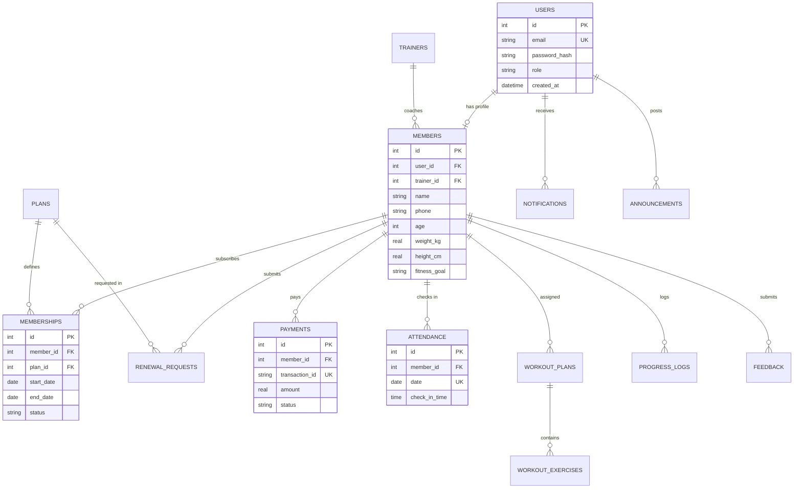

# ⚡ IronPulse – Gym Membership Manager

> **College Mini Project** | Database Management Systems (DBMS) & Web Engineering  
> A full-stack, zero-setup fitness membership manager featuring real-time membership countdowns, relational SQLite schema with strict integrity constraints, automated renewal extensions, attendance streak tracking, and interactive Chart.js analytics.

---

## 📋 Table of Contents
1. [Project Overview](#-project-overview)
2. [Tech Stack](#-tech-stack)
3. [Core Feature: Real-Time Membership Countdown](#-core-feature-real-time-membership-countdown)
4. [User Roles & Feature Breakdown](#-user-roles--feature-breakdown)
5. [Database Architecture & DBMS Concepts](#-database-architecture--dbms-concepts)
   - [Relational Schema (14 Tables)](#relational-schema-14-tables)
   - [Constraints & Integrity Rules](#constraints--integrity-rules)
   - [Performance Indexes](#performance-indexes)
   - [Entity-Relationship (ER) Diagram](#entity-relationship-er-diagram)
6. [REST API Documentation](#-rest-api-documentation)
7. [Getting Started (Zero Setup)](#-getting-started-zero-setup)
8. [Demo Credentials & Sample Data](#-demo-credentials--sample-data)
9. [Automated Verification & Testing](#-automated-verification--testing)

---

## 🚀 Project Overview

**IronPulse** is built to solve common membership tracking challenges in fitness centers. Traditional gym software either requires complex cloud infrastructure or stores static membership flags. IronPulse eliminates both:
- **Zero Configuration**: Uses embedded `better-sqlite3` — no database servers, credentials, or installation required.
- **Dynamic Calculation**: Remaining days and percentage used are **calculated on-the-fly relative to the current calendar date**, eliminating stale database state.
- **Academic Rigor**: Demonstrates advanced DBMS concepts including cascading foreign keys, multi-column unique constraints (`UNIQUE(member_id, date)`), domain check constraints, and performance indexes.

---

## 🛠 Tech Stack

| Layer | Technology | Rationale |
|---|---|---|
| **Frontend** | HTML5, CSS3, Vanilla JavaScript (ES6+) | Lightweight, mobile-first, zero framework bloat, fast load times |
| **Data Viz** | Chart.js (via CDN) | Responsive weight progress graphs, revenue trends, doughnut charts |
| **Backend** | Node.js & Express.js | Modular REST API architecture with dedicated routes, controllers, middleware |
| **Database** | SQLite via `better-sqlite3` | Zero-setup, high-performance synchronous queries, ACID compliant |
| **Security** | JWT (JSON Web Tokens) & `bcryptjs` | Stateless session management with salted password hashing |

---

## ⏳ Core Feature: Real-Time Membership Countdown

The heartbeat of IronPulse is its **Dynamic Membership Countdown**:

### 1. Calculation Logic
Remaining days and percentage elapsed are **never stored as static integers**. Whenever the member or admin views the dashboard, the backend computes:

$$\text{Total Duration} = \max(1, \text{Round}\left(\frac{\text{EndDate} - \text{StartDate}}{86400000}\right))$$

$$\text{Days Left} = \left\lceil \frac{\text{EndDate} - \text{Today}}{86400000} \right\rceil$$

$$\% \text{ Used} = \min\left(100, \max\left(0, \text{Round}\left(\frac{\text{Total Duration} - \max(0, \text{Days Left})}{\text{Total Duration}} \times 100\right)\right)\right)$$

### 2. Color-Coded Statuses
| Remaining Days | Color | Badge | UI Behavior |
|---|---|---|---|
| **> 15 Days** | 🟢 Neon Green (`#00E676`) | `Active` | Standard progress ring with green stroke glow |
| **7 – 15 Days** | 🟠 Electric Amber (`#FF9800`) | `Expiring Soon` | Amber progress ring |
| **1 – 6 Days** | 🔴 Vibrant Red (`#FF334B`) | `Expiring Soon` | Red ring + **Pulsating Warning Banner** with instant "Renew Now" button |
| **$\le$ 0 Days** | ⚪ Muted Grey (`#6B7280`) | `Expired` | Grey ring + Expiry notice with "Renew Now" button |

### 3. Visual SVG Progress Ring
A circular SVG gauge uses `stroke-dashoffset` to smoothly animate the percentage of time remaining:
```javascript
const circumference = 2 * Math.PI * 85; // 534.07px
const offset = circumference - ((100 - percentUsed) / 100) * circumference;
circle.style.strokeDashoffset = offset;
```

---

## 👥 User Roles & Feature Breakdown

### 1. Member Portal (`/member` or `member-dashboard.html`)
- **Dashboard**: Circular SVG countdown ring, today's workout preview, streak counter, and quick stats.
- **Urgent Warning Banner**: Automatically appears when 7 days or fewer remain with a one-click renewal trigger.
- **Attendance Calendar**: Monthly interactive grid highlighting attended days in green, displaying current unbroken streak and monthly percentage.
- **Self Check-In**: Quick button to check in for the day (protected against duplicate submissions).
- **Workout Routine**: Day-wise view of exercises, sets, reps, and notes assigned by the trainer, with interactive completion checkboxes.
- **Transformation Tracker**: Weight and body measurement log with interactive **Chart.js** line graph.
- **BMI & Calorie Target**: Dynamic BMI calculator with category badge and **Mifflin-St Jeor** suggested daily caloric intake tailored to fitness goals (Weight Loss, Hypertrophy, Maintenance).
- **Renewal Requests**: Select from Monthly, Quarterly, Half-Yearly, or Yearly plans; admin approval seamlessly extends active dates.
- **Payment Ledger**: Audit trail of simulated transaction receipts.
- **Feedback & Rating**: Rate gym facility or specific trainer (1 to 5 stars) with comments.
- **In-App Notifications**: Alerts for expiry warnings, renewal approvals, and announcements.
- **Dark / Light Mode**: Persistent theme toggle.

### 2. Admin Portal (`/admin` or `admin-dashboard.html`)
- **Overview & KPIs**: 6 live counters: Total Members, Active, Expiring in 7 Days, Expired, Today's Check-ins, and Monthly Revenue.
- **Analytics Visualizations (Chart.js)**:
  1. *New Members Growth* (Bar Chart)
  2. *Monthly Revenue Trend* (Line/Area Chart)
  3. *Plan Distribution* (Doughnut Chart)
- **Member Directory**:
  - Live search by Name, Email, or Phone.
  - Quick filter pills: `All`, `Active`, `Expiring Soon`, `Expired`.
  - Add new member modal (with user account, plan assignment, and initial baseline metrics).
  - Edit member profile and expiry date.
  - Delete member (cascades to all related records).
  - One-click **Send Renewal Reminder** button.
- **Mark Attendance Console**:
  - Searchable member check-in dropdown.
  - Enforces database constraint: duplicate check-ins on the same day are rejected with a clear error.
  - Live table of today's verified check-ins with timestamps.
- **Renewal Approval Queue**:
  - Review pending member renewal submissions.
  - **Auto-Extension Engine**: If current membership is active, extends from existing end date; if expired, extends from today. Automatically logs simulated payment and notifies the member.
  - Reject renewal with customizable reason.
- **Workout Template Management**:
  - Pre-built templates: *Beginner Full Body Foundation*, *Hypertrophy Push-Pull-Legs*, *HIIT & Metabolic Shred*.
  - One-click routine assignment to any registered member.
- **Trainer Management**:
  - Add coaches with specialties and biographies.
  - Real-time counters showing number of athletes assigned to each coach.
- **Broadcast Announcements**:
  - Publish notices with Normal or Urgent priority to member bulletins.
- **CSV Data Exports**:
  - One-click download of all member records (`IronPulse_Members_YYYY-MM-DD.csv`).
  - One-click download of all payment transactions (`IronPulse_Payments_YYYY-MM-DD.csv`).
- **Feedback Review**: Inspect member ratings and comments.

---

## 🗄 Database Architecture & DBMS Concepts

The application uses **SQLite 3** (`database/ironpulse.db`) with strict relational integrity, foreign keys enabled (`PRAGMA foreign_keys = ON;`), and WAL mode (`PRAGMA journal_mode = WAL;`).

### Relational Schema (14 Tables)

1. **`users`**: Base credentials and role permissions (`admin` or `member`).
2. **`trainers`**: Certified instructors with contact details and specialties.
3. **`members`**: Physical athlete profiles linked 1:1 to `users(id)` and N:1 to `trainers(id)`.
4. **`plans`**: Subscription packages (duration in days, price, description).
5. **`memberships`**: Subscriptions linking `members(id)` and `plans(id)` with `start_date`, `end_date`, and status.
6. **`renewal_requests`**: Member plan extension submissions under staff review.
7. **`payments`**: Transaction records with unique `transaction_id`, amounts, and methods.
8. **`attendance`**: Daily check-in records.
9. **`workout_plans`**: Routine headers (templates or member-specific).
10. **`workout_exercises`**: Day-wise breakdown of exercises, sets, and repetitions.
11. **`progress_logs`**: Historical weight, chest, waist, and biceps measurements.
12. **`notifications`**: User-specific in-app alerts and notifications.
13. **`announcements`**: Gym-wide notices posted by administrators.
14. **`feedback`**: Member reviews and star ratings (1 to 5).

### Constraints & Integrity Rules
- **Referential Integrity (`ON DELETE CASCADE`)**: Deleting a user automatically cascades to their member profile, attendance, progress logs, and notifications.
- **Set Null Policy (`ON DELETE SET NULL`)**: Removing a trainer sets the member's `trainer_id` to NULL without deleting the member.
- **Daily Attendance Constraint**:
  ```sql
  CONSTRAINT uq_member_attendance_per_day UNIQUE(member_id, date)
  ```
  Prevents duplicate check-ins on the same calendar day at the database engine level.
- **Domain Check Constraints**:
  - `CHECK(role IN ('admin', 'member'))`
  - `CHECK(rating >= 1 AND rating <= 5)`
  - `CHECK(duration_days > 0)` and `CHECK(price >= 0)`
  - `CHECK(age > 0 AND age < 120)` and `CHECK(height_cm > 50 AND height_cm < 300)`

### Performance Indexes
Optimized for high-frequency queries:
```sql
CREATE INDEX idx_members_user ON members(user_id);
CREATE INDEX idx_memberships_member ON memberships(member_id, status);
CREATE INDEX idx_attendance_member_date ON attendance(member_id, date);
CREATE INDEX idx_payments_member ON payments(member_id);
CREATE INDEX idx_progress_member_date ON progress_logs(member_id, log_date);
CREATE INDEX idx_notifications_user_read ON notifications(user_id, is_read);
```

### Entity-Relationship (ER) Diagram



---

## 📡 REST API Documentation

### 1. Authentication (`/api/auth`)
| Method | Endpoint | Description | Access |
|---|---|---|---|
| `POST` | `/api/auth/register` | Register new member profile & subscription | Public |
| `POST` | `/api/auth/login` | Authenticate email & password, returns JWT | Public |
| `GET` | `/api/auth/me` | Fetch authenticated user context | Member / Admin |

### 2. Member Portal (`/api/member`)
| Method | Endpoint | Description | Access |
|---|---|---|---|
| `GET` | `/api/member/dashboard` | Consolidated countdown, streak, workout & stats | Member |
| `PUT` | `/api/member/profile` | Update physical metrics (weight, height, goal) | Member |

### 3. Attendance (`/api/attendance`)
| Method | Endpoint | Description | Access |
|---|---|---|---|
| `POST` | `/api/attendance/checkin` | Record daily check-in (`UNIQUE` constraint) | Member / Admin |
| `GET` | `/api/attendance/my` | Member attendance calendar dates & streak | Member |
| `GET` | `/api/attendance/today` | List of all check-ins recorded today | Admin |

### 4. Renewals (`/api/renewals`)
| Method | Endpoint | Description | Access |
|---|---|---|---|
| `POST` | `/api/renewals/request` | Submit renewal request with desired plan | Member |
| `GET` | `/api/renewals` | List pending renewal requests | Admin |
| `POST` | `/api/renewals/:id/approve` | Approve renewal (auto-extends end date) | Admin |
| `POST` | `/api/renewals/:id/reject` | Reject renewal with note | Admin |

### 5. Admin Management (`/api/admin`)
| Method | Endpoint | Description | Access |
|---|---|---|---|
| `GET` | `/api/admin/stats` | KPI counters (Active, Expiring, Revenue, etc.) | Admin |
| `GET` | `/api/admin/analytics` | Growth, revenue trends, and plan distribution | Admin |
| `GET` | `/api/admin/members` | Filter/search members with live countdown | Admin |
| `POST` | `/api/admin/members` | Register new member directly | Admin |
| `PUT` | `/api/admin/members/:id` | Update member details or extend end date | Admin |
| `DELETE` | `/api/admin/members/:id` | Delete member and cascade records | Admin |
| `POST` | `/api/admin/remind/:id` | Dispatch renewal reminder notification | Admin |
| `POST` | `/api/admin/announcements` | Publish gym announcement bulletin | Admin |
| `GET` | `/api/admin/export/members` | Download CSV of all gym members | Admin |
| `GET` | `/api/admin/export/payments` | Download CSV of all payment receipts | Admin |

---

## ⚡ Getting Started (Zero Setup)

### Prerequisites
- **Node.js** (v18.0.0 or higher recommended)
- **npm** (included with Node.js)

### Quick Run
```bash
# 1. Clone or navigate to the project root
cd scratch/ironpulse-gym

# 2. Install dependencies (better-sqlite3, express, bcryptjs, jsonwebtoken, cors)
npm install

# 3. Seed database with demo accounts across all countdown states
npm run seed

# 4. Start the application
npm start
```

Open your browser to:
- **Landing Page**: [http://localhost:3000](http://localhost:3000)
- **Admin Portal**: [http://localhost:3000/admin](http://localhost:3000/admin)
- **Member Portal**: [http://localhost:3000/member](http://localhost:3000/member)

---

## 🔑 Demo Credentials & Sample Data

The seed script creates **1 admin**, **2 coaches**, and **15 realistic members** pre-configured into distinct countdown states:

| Role | Email | Password | Membership State & Demo Purpose |
|---|---|---|---|
| **Gym Admin** | `admin@gym.com` | `admin123` | Full access to KPI stats, check-in console, approvals, and exports |
| **Member (Alex)** | `alex.member@gym.com` | `member123` | 🔴 **Expiring in 3 Days** — Demonstrates Red Ring & Warning Banner |
| **Member (Rachel)** | `rachel.member@gym.com` | `member123` | 🟠 **Expiring in 14 Days** — Demonstrates Amber warning ring |
| **Member (Sarah)** | `sarah.member@gym.com` | `member123` | 🟢 **240 Days Remaining** — Demonstrates Active Green pass |
| **Member (Arthur)** | `arthur.member@gym.com` | `member123` | ⚪ **Expired 5 Days Ago** — Demonstrates Grey expired ring & renewal CTA |

> **Pro-Tip**: The landing page includes **one-click autofill buttons** for all demo accounts so evaluators can test instantly without typing!

---

## 🧪 Automated Verification & Testing

IronPulse includes an automated test runner that verifies all DBMS constraints and business logic:

```bash
npm test
```

### Verified Test Cases:
1. **Dynamic Countdown Calculations**: Correct color thresholds (Green >15d, Orange 7–15d, Red <7d, Grey Expired).
2. **Health Metrics**: Accurate BMI calculation and Mifflin-St Jeor TDEE calorie formulas.
3. **Authentication**: JWT token issuance and bcrypt password verification.
4. **Attendance Constraint**: Confirms `UNIQUE(member_id, date)` rejects duplicate daily check-ins with HTTP 400.
5. **Renewal Auto-Extension**: Verifies that approving a 30-day renewal extends the subscription end date by exactly 30 days.
6. **CSV Exports**: Validates `text/csv` headers and properly formatted data rows.

---

## 🎓 Academic Mini Project Declaration
*Developed for College Mini Project Coursework (Database Management Systems & Web Technologies). Designed, implemented, and verified with zero paid services, clean modular code, and comprehensive commenting.*
